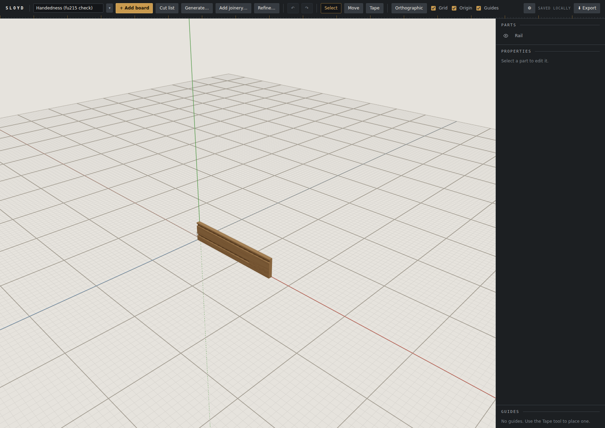
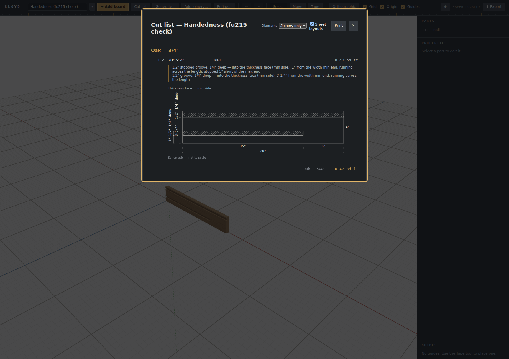

# Browser verification — posture handedness and true sheet views (2026-10-10)

Dev server (`--port 5199`) on branch `posture-handedness` at `fe420be`, Playwright MCP, software GL.
No paid runs.

## The file

A hand-written **v11** project: one on-edge "Rail" (20 × 4 × 3/4in, turn 0, at the origin) with two
dados on its thickness MAX side — under the v11 frame that is the world +Z face, the face toward the
default camera:
- `c1`: 1/2in wide, 1/4in deep, positioned 1in up the width, stopped 5in short of the length's max (+X) end;
- `c2`: 1/2in wide, positioned 3-1/4in up the width (near the top edge), running the full length.

## 1. Migration on import

Imported through the project menu. Stored back as **version 12**; both cuts now `from: 'min'`, offsets and
stops unchanged (a cut INTO thickness only flips its side when mirrored along thickness).

## 2. The 3D view — nothing moved

Both grooves are on the face toward the camera (+Z), as under v11: the lower one stops short of the +X end,
the upper one runs through.

## 3. The sheet — a true view

"Thickness face — min side" (a `vUp` view): width grows UPWARD, so the stopped groove sits 1in above the
BOTTOM edge and stops 5in short of the RIGHT end; the full groove sits near the top — exactly the face as
seen from the front in the 3D view. Under the old sheet (width growing down) this view would have shown
the mirror image. The flipped columns' labels (the depth label lifted above the outline, the final-review
packing fix) read cleanly with no overlap.

## Console / cleanup

0 errors; warnings only the known Three.js deprecations. The imported project was deleted through the
menu after re-opening the previously active project; 16 projects, the same active id, the key present, no
orphaned project keys (read back).
